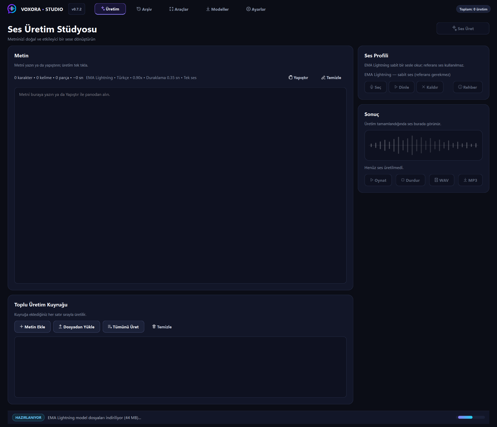

# VoxoraStudio — Yerel çok dilli seslendirme stüdyosu

> English: [README.md](./README.md)

Chatterbox Multilingual V3 tabanlı, PyQt6 arayüzlü metinden sese üretim stüdyosu. Türkçe + çok dilli, referans örnekle ses klonlama, WAV/MP3 dışa aktarma — CPU/CUDA/DirectML ile tam yerel çalışır.



## Özellikler

- **Türkçe + çok dilli TTS** — Chatterbox V3 motoru.
- **Ses klonlama** — referans örnek (5–20 sn öneri) + rehber düğmesi.
- **İnce ayar** — dil, hız, ifade, netlik, yaratıcılık, tekrar azaltma + hazır presetler.
- **Uzun metin parçalama** — parça işleme + süre tahmini, karakter/kelime/parça bilgisi.
- **WAV + MP3** — ffmpeg ile 128/192/320 kbps.
- **Otomatik donanım** — CPU/CUDA seçimi + DirectML/ONNX.
- **Üretim geçmişi** — otomatik kayıt (`outputs/`), geri al, toplu sil, Geri Dönüşüm'e taşı.
- **Hızlı giriş** — pano yapıştırma, metin temizleme, kısayollar (Ctrl+Enter, Ctrl+S…).
- **Kalıcı durum** — ayarlar (`state/`), üretim sayacı, loglar.
- **İlerleme arayüzü** — model/üretim ilerleme pencereleri, ilk üretimde referans-ses uyarısı.

## Hızlı başlangıç

Gereksinim: Python 3.11 + ffmpeg (MP3 için).

```bat
setup.bat          :: internet/donanım/ffmpeg kontrolü, CUDA yoksa CPU
install_check.bat  :: kurulum doğrulama
run.bat            :: konsolsuz başlat (debug: VOXORA_SHOW_CONSOLE=1)
build.bat          :: paketleme dist\VoxoraStudio-0.5.0\ (PyInstaller onedir)
```

Test: `smoke_test.py` (light/full), `python -m unittest discover -s tests -v`.

Eski otomasyonlar için `TXTOTTS_SHOW_CONSOLE` ve `TXTOTTS_HIDDEN` değişkenleri geriye dönük uyumluluk amacıyla kabul edilir (`VOXORA_SHOW_CONSOLE` / `VOXORA_HIDDEN` olarak eşlenir).

## Proje yapısı

```text
app.py               giriş noktası (arayüz app/ paketinde)
app/                 main_window, dialogs, workers, theme, icons, widgets
tts_engine.py        TTS motoru
audio_compressor.py  MP3 dışa aktarma
audio_player.py      önizleme oynatma
chunker.py           uzun metin bölme
config.py            ayarlar (app_state.py, state/)
scripts/             setup_env, gpu_detect, export_onnx
tests/  outputs/  models/  logs/  docs/
```

## Katkı

Küçük PR, commit'e model dosyası/çıktı konmaz. Bkz. [.github/PULL_REQUEST_TEMPLATE.md](./.github/PULL_REQUEST_TEMPLATE.md).

## Lisans

Bkz. [LICENSE](./LICENSE) (bekliyor — teyit edilecek).
