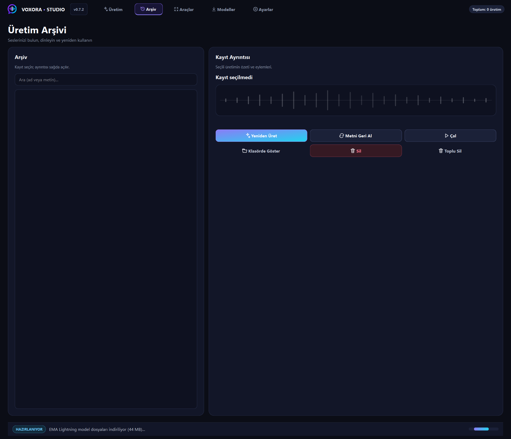
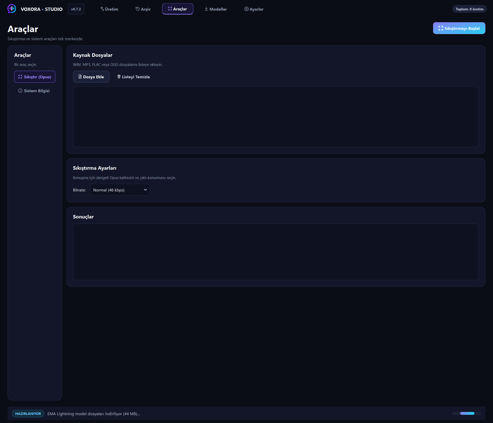
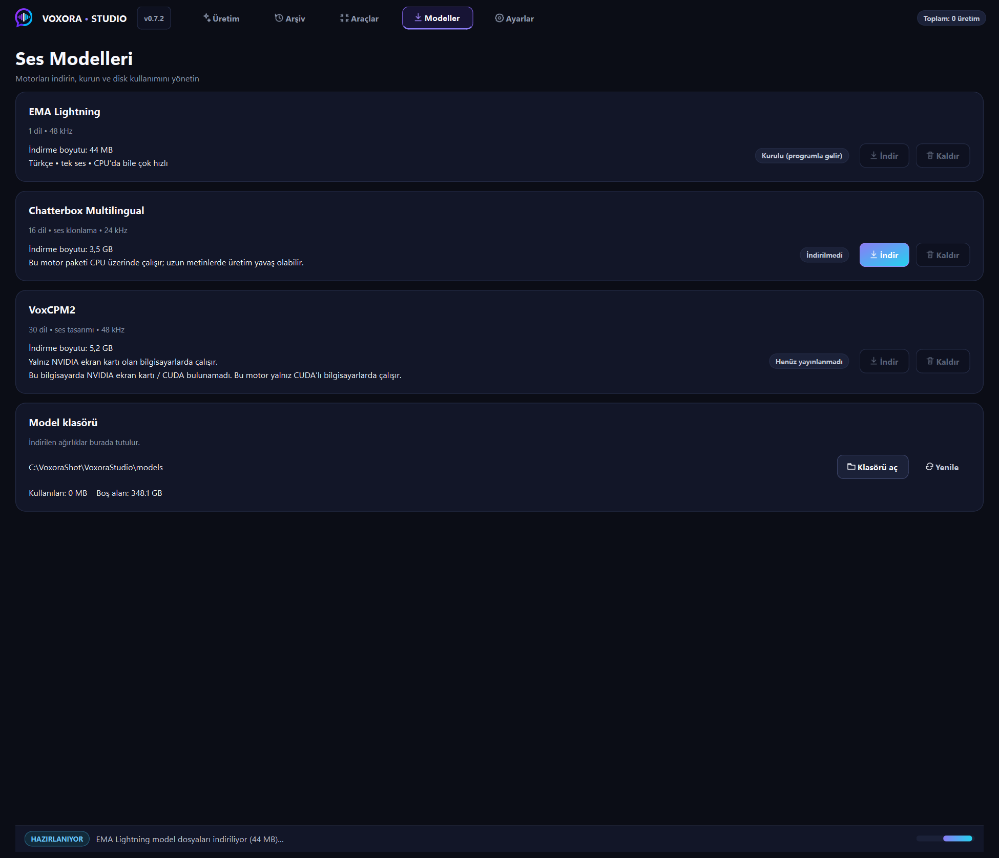
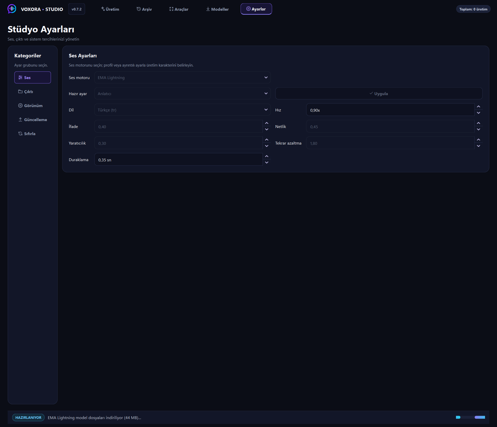

# VoxoraStudio — yerel çok dilli seslendirme stüdyosu

> English: [README.md](./README.md)

**Metni yaz, sesi seç, dinle. Hiçbir şey makineden çıkmaz.**

VoxoraStudio tamamen kendi bilgisayarında çalışan bir PyQt6 metinden sese stüdyosudur. Kurulumla **EMA Lightning** gelir — Türkçe, tek ses, 48 kHz, CPU'da bile hızlı. **Chatterbox** (16 dil ve ses klonlama) ile **VoxCPM2** (30 dil ve ses tasarımı) yalnız istersen uygulama içinden indirilir.


---

## İçindekiler

- [Ne yapar](#ne-yapar)
- [Ekranlar, tek tek](#ekranlar-tek-tek)
  - [1. Üretim](#1-üretim)
  - [2. Arşiv](#2-arşiv)
  - [3. Araçlar](#3-araçlar)
  - [4. Modeller](#4-modeller)
  - [5. Ayarlar](#5-ayarlar)
- [Kurulum](#kurulum)
- [Motorlar](#motorlar)
- [Dosyalar nerede](#dosyalar-nerede)
- [Kaynaktan derleme](#kaynaktan-derleme)
- [Bilinmesi gereken sınırlar](#bilinmesi-gereken-sınırlar)
- [Lisans](#lisans)

---

## Ne yapar

| Yetenek | Ayrıntı |
|---|---|
| **Üç motor, seçim senin** | EMA uygulamayla gelir; Chatterbox ve VoxCPM2 Modeller sekmesinden indirilir. Arka planda hiçbir şey inmez |
| **Ses klonlama** | 5–20 saniyelik referans örnek; Chatterbox ve VoxCPM2 |
| **Ses tasarımı** | referans ses olmadan, yazılı tarifle yeni ses (yalnız VoxCPM2) |
| **Donanım kapısı** | VoxCPM2 yalnız NVIDIA/CUDA olan bilgisayarlarda — aksi halde düğme kapalı ve kart nedeni yazıyor |
| **İnce ayar** | dil, hız, ifade, netlik, yaratıcılık, tekrar azaltma ve hazır ayarlar |
| **Uzun metin parçalama** | parçalara böl, parça başına işle, başlamadan süre tahmini |
| **WAV + MP3 + OPUS** | ffmpeg üzerinden biçime göre kalite seçimi |
| **Üretim arşivi** | otomatik kayıt, yeniden çal, kaynak metni geri al, klasörde göster, Geri Dönüşüm'e sil |
| **Toplu kuyruk** | çok satırı yapıştır veya metin dosyası yükle, hepsini üret |
| **Kurulumlu sürüm** | Windows kurulumu, kendi kendine güncelleme, ayarlar ve modeller korunur |

---

## Ekranlar, tek tek

### 1. Üretim


Varsayılan çalışma alanı, üç sütuna bölünmüş.

**Sol — metin**
- Metin kutusu ve canlı sayaç: karakter, kelime, parça, tahmini süre.
- `Yapıştır` ve `Temizle`.
- Kutunun altındaki etkin yapılandırma şeridi: motor, dil, hız (`0.90x`), duraklama (`0.35 sn`), ses modu (`Tek ses`).

**Sağ — ses profili ve sonuç**
- **Ses Profili** — etkin motor kartı (`EMA Lightning`, *sabit ses, referans gerekmez*), `Seç`, `Dinle`, `Kaldır`, `Rehber` ile.
- **Sonuç** — üretimden sonra dalga formu burada görünür; `Oynat`, `Durdur`, `WAV`, `MP3`.

**Alt — toplu üretim kuyruğu**
- `+ Metin Ekle`, `Dosyadan Yükle`, `Tümünü Üret`, `Temizle`.
- Kuyruktaki her satır sırayla üretilir; kuyruk yeniden başlatmadan sağ çıkar.

Sağ üstteki `Ses Üret` çalıştırmayı başlatır. Alt durum çubuğu her zaman motoru ve kullandığı aygıtı gösterir — `HAZIR · Hazır · EMA Lightning (cpu)`.

Başlıkta ayrıca bir toplam sayaç (`Toplam: 0 üretim`) durur; Arşiv'i açmadan ne kadar ürettiğini bilirsin.

### 2. Arşiv



Her üretim, en yenisi üstte.

- Arama kutusu ve dosya listesi.
- Sağda **Kayıt Ayrıntısı**: seçili üretimin özeti ve eylemleri.
- `Yeniden Üret` — saklanan metinden yeniden üretir.
- `Metni Geri Al` — özgün metni Üretim kutusuna geri koyar.
- `Çal`, `Klasörde Göster`, `Sil`, `Toplu Sil`.

Silmek dosyaları yok etmek yerine Geri Dönüşüm Kutusu'na taşır. Her kayıt kaynak metnini saklar; yeniden üretilen kayıt özgünü üreten metnin tam kendisini kullanır.

### 3. Araçlar



Tek sayfa değil, iki yardımcı.

**Sıkıştır (Opus)**
- Kaynak dosyalar: WAV, MP3, FLAC, OGG. `Dosya Ekle`, `Listeyi Temizle`.
- Bitrate seçimi — `Normal (48 kbps)` ve üst seçenekler.
- `Sonuçlar` neyin nereye üretildiğini gösterir.

**Sistem Bilgisi** — motor kullanılabilirliği, aygıt ve uygulamanın motoru açmadan önce denetlediği donanım bilgileri.

Sıkıştırma paketteki ffmpeg ile yerelde çalışır; yükleme yok, üçüncü taraf yeniden kodlama yok.

### 4. Modeller



Motor başına bir kart: ne kadar yer kapladığı ve burada çalışıp çalışamayacağı.

| Motor | Boyut | Diller | Durum |
|---|---|---|---|
| **EMA Lightning** | 44 MB | 1 (Türkçe) | uygulamayla kurulu |
| **Chatterbox Multilingual** | 3,5 GB | 16, ses klonlama dahil | indirilmedi |
| **VoxCPM2** | 5,2 GB | 30, ses tasarımı dahil | bu makine için yayımlanmadı |

Her kartta durum rozeti — `Kurulu (programla gelir)`, `İndirilmedi`, `Henüz yayınlanmadı` — ve `İndir` / `Kaldır` düğmeleri var.

VoxCPM2 donanıma bağlı: *"Yalnız NVIDIA ekran kartı olan bilgisayarlarda çalışır. Bu bilgisayarda NVIDIA ekran kartı / CUDA bulunamadı."* Kart, çalışmayacak bir indirme sunmak yerine bunu açıkça söyler.

**Model klasörü** alt şeridi ağırlıkların nerede durduğunu, ne kadar yer tuttuğunu (`Kullanılan: 33 MB`) ve boş alanı gösterir; `Klasörü aç` / `Yenile` ile. Kurulum ve kaldırma bu klasöre dokunmaz, yani indirilen motorlar güncellemelerden sağ çıkar.

### 5. Ayarlar



Solda beş bölüm, her birinin kendi paneli.

**Ses**
- Motor, hazır ayar, dil ve beş ayar: ifade, yaratıcılık, duraklama, hız, netlik, tekrar azaltma.
- `Uygula` değişikliği uygular. Hazır ayarlar (`Anlatıcı` ve diğerleri) sıfırdan ayar yapmak zorunda kalmadan bilinen iyi bir bileşim kurar.

**Çıktı** — biçim, kalite, çıktı klasörü.

**Görünüm** — tema ve yerleşim.

**Güncelleme** — güncelleme denetimi; SHA-256 doğrulanır ve program yerinde değiştirilir, ayarlar, çıktılar ve modeller korunur.

**Sıfırla** — ayarları varsayılana döndürür. Bu tercihleri sıfırlar, üretimlerini değil.

---

## Kurulum

`VoxoraStudio-<sürüm>-Setup.exe` dosyasını çalıştır (~180 MB).

| Ne | Nerede | Güncelleme siler mi? |
|---|---|---|
| Program (EXE + kütüphaneler + ffmpeg + EMA modeli) | `C:\Program Files\VoxoraStudio` | Evet — yerine yenisi yazılır |
| Ayarlar, geçmiş, çıktılar, loglar | `%LOCALAPPDATA%\VoxoraStudio` | **Hayır** |
| İndirilen motorlar ve modeller | `%LOCALAPPDATA%\VoxoraStudio\engines` ve `\models` | **Hayır** |

Kurulum masaüstü ve Başlat Menüsü kısayolları oluşturur. Kaldırmada ayarlar, çıktılar ve indirilmiş modeller korunur.

## Motorlar

| Motor | Diller | Ses klonlama | Ses tasarımı | Donanım |
|---|---|---|---|---|
| **EMA Lightning** | Türkçe | yok (tek sabit ses) | yok | CPU, uygulamayla gelir |
| **Chatterbox Multilingual** | 16 | var | yok | CPU çalışır; uzun metinde yavaş |
| **VoxCPM2** | 30 | var | var | NVIDIA/CUDA gerekir |

Hiçbiri `İndir` düğmesine basmadan inmez. Her kart indirme başlamadan boyutu ve gereksinimi yazar.

## Dosyalar nerede

| Ne | Nerede |
|---|---|
| Program | `C:\Program Files\VoxoraStudio` |
| Ayarlar, geçmiş, çıktılar, loglar | `%LOCALAPPDATA%\VoxoraStudio` |
| Motorlar | `%LOCALAPPDATA%\VoxoraStudio\engines` |
| Modeller | `%LOCALAPPDATA%\VoxoraStudio\models` |
| Güncellemeler | `%LOCALAPPDATA%\VoxoraStudio\updates` |

Ayrım şundan: kurulum program klasörünü tepeden tırnağa değiştirir. Dışarıdaki kullanıcı verisi her güncellemeden sağ çıkar.

## Ortam değişkenleri

| Değişken | Etkisi |
|---|---|
| `VOXORA_SHOW_CONSOLE` | başlatıcı açılırken konsol penceresini görünür tutar |
| `VOXORA_HIDDEN` | görünür pencere olmadan, gizli başlatır |

`run.bat` ayrıca adlandırma değişikliğinden önceki `TXTOTTS_SHOW_CONSOLE` ve `TXTOTTS_HIDDEN` adlarını takma ad olarak kabul eder; eski başlatıcıya göre yazılmış betikler çalışmaya devam eder. İkisi de tanımlıysa yeni `VOXORA_*` adları kazanır.

## Kaynaktan derleme

```powershell
python -m venv .venv
.\.venv\Scripts\pip install -r requirements.txt
.\.venv\Scripts\python.exe app.py
```

Duman testi ve paketleme:

```powershell
.\.venv\Scripts\python.exe smoke_test.py
```

`smoke_test.py` birim testlerini, kritik ve yerel içe aktarma denetimlerini, ortam denetimini ve isteğe bağlı entegrasyon çalıştırmasını koşar. Paketleme, projenin derleme betikleriyle kurulum dosyasını üretir; sürüm `app/version.py` içinde yaşar.

## Bilinmesi gereken sınırlar

- EMA Lightning yalnız Türkçe ve tek ses. Amaç zaten bu — hızlı ve her zaman hazır yol.
- VoxCPM2 AMD veya Intel GPU'da kullanılamaz; kart, aksini iddia etmek yerine indirmeyi kapatır.
- Chatterbox CPU'da uzun metinde yavaştır; başlamadan parça ilerlemesi ve süre tahmini gösterilir.
- Arşivden silmek dosyaları Geri Dönüşüm'e taşır; disk alanı ancak kutu boşaltıldığında geri kazanılır.

## Lisans

MIT — bkz. [LICENSE](./LICENSE).
